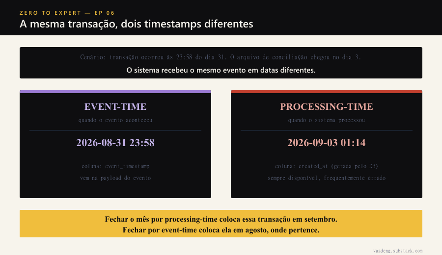
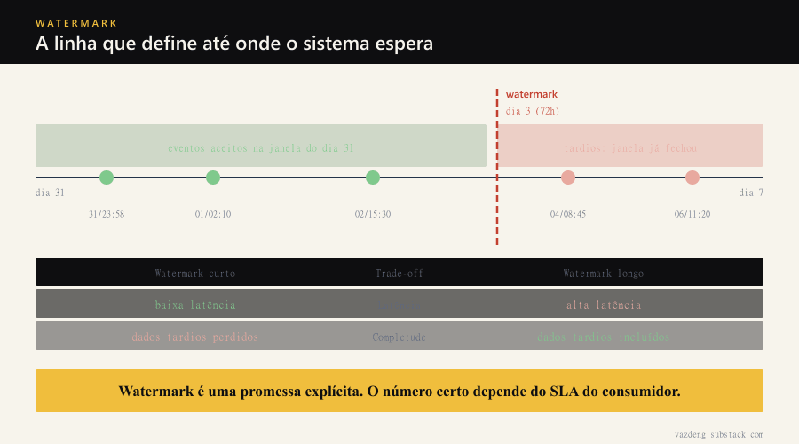

Fechei o mês. Dois dias depois, o número mudou sozinho.

Ninguém lançou nada novo. Uma transação com data do mês passado chegou atrasada, e o total que eu já tinha fechado ficou errado.

Isso não é bug de sistema. É consequência de uma decisão de modelagem que a maioria dos pipelines não toma explicitamente: qual é o tempo que define onde um evento pertence?

## Dois tempos, uma confusão frequente

Toda pipeline lida com dois tempos distintos.

O **processing-time** é quando o sistema processou o dado. É o timestamp que o banco de dados grava automaticamente. É fácil de medir, sempre disponível, e frequentemente é o tempo errado para usar em agregações de período.

O **event-time** é quando o evento aconteceu no mundo real. A transação que ocorreu às 23:58 do dia 31, mas cujo arquivo de conciliação chegou três dias depois, tem event-time de dia 31 e processing-time de dia 3 do mês seguinte.

Martin Kleppmann descreve esse problema em *Designing Data-Intensive Applications*: usar processing-time para fechar períodos produz resultados que dependem de quando o dado chegou, não de quando o evento aconteceu. Tyler Akidau e equipe formalizaram o trade-off no Dataflow Model (VLDB 2015): em streams unbounded e fora de ordem, você está sempre equilibrando correção, latência e custo.

A pergunta que você não quer descobrir tarde: seu pipeline usa qual dos dois?

## O anti-padrão: o dado chegou tarde, o número mudou

Um pipeline batch diário roda às 01h00 e agrega todos os eventos do dia anterior. Parece completo. O problema é o "todos".

Sistemas externos entregam dados com atraso por razão operacional legítima. Arquivos de conciliação financeira chegam com D+1 a D+3 de atraso em pipelines típicos. Eventos de aplicativo com problema de conectividade chegam em lote quando a conexão volta. Sensores industriais bufferizam e enviam em batch. Integrações de parceiros rodam janelas próprias de processamento.

Se o pipeline roda às 01h00 e fecha o dia, qualquer dado que chegar depois não entra, ou entra no dia errado, dependendo de como a janela foi implementada. O resultado é um fechamento que parece certo no momento em que você olha e está errado na hora em que você precisa reportar.

## Watermark: a promessa explícita sobre o passado

A solução não é esperar para sempre. É declarar explicitamente até quanto atraso você tolera.

Um watermark é uma linha no tempo que o sistema traça e diz: "eventos com event-time antes deste ponto já chegaram todos, ou chegaram os suficientes para o propósito do período." Com um watermark de 72 horas, o fechamento do dia 31 espera até o dia 3 antes de considerar encerrado. Dados que chegam depois disso vão para uma janela de reprocessamento ou são tratados como tardios de forma explícita.

O ponto crítico é que o watermark é uma declaração, não uma garantia mágica. Ele define o trade-off entre latência e completude. Watermark de 1 hora fecha rápido e aceita perder dados tardios. Watermark de 7 dias fecha com completude alta e latência alta. O número certo depende do SLA do consumidor e da característica da fonte.

O Spark Structured Streaming implementa com `.withWatermark("event_time", "72 hours")`. O sistema descarta automaticamente eventos que chegam depois do watermark da janela já fechada. O que você escolhe é o parâmetro: a tolerância declarada ao atraso.

## Quando NÃO modelar event-time

Nem toda pipeline precisa. Dado estático, como snapshot diário de uma tabela relacional onde o estado do sistema é capturado por completo no momento do batch, tem processing-time igual ao event-time por definição. Se a fonte nunca entrega dado com atraso relevante para o período de fechamento, processing-time resolve com muito menos complexidade.

O sinal de que você precisa de event-time: a fonte produz dado que chega fora de ordem ou com atraso sistemático, e o resultado do pipeline muda dependendo de quando o dado chegou. Se o fechamento mensal do mês passado teria sido diferente caso um arquivo tivesse chegado um dia antes, esse é event-time não modelado.

## O que o Ep 06 adiciona ao Ep 03

Uso event_time como primeira decisão de modelagem em qualquer pipeline que lida com atraso sistemático. No Ep 03 desta série, vi que a idempotência depende disso: rodar o pipeline duas vezes não pode mudar o resultado. Event-time e watermark estendem esse princípio para o tempo.

Sem event-time modelado, idempotência em reprocessamento vira ficção. Os dados que chegaram tarde entram em períodos errados ou são ignorados, e cada reprocessamento dá um número diferente dependendo de quando ele roda. A janela de reprocessamento com watermark resolve isso: o período só fecha quando o watermark passou, e reprocessar esse período sempre inclui os mesmos dados.

A próxima vez que alguém perguntar por que o número do fechamento mudou dois dias depois de ter sido publicado, a resposta provavelmente está aqui: alguém assumiu que "batch diário" significa "dados completos do dia", e event-time nunca foi uma coluna do modelo.
