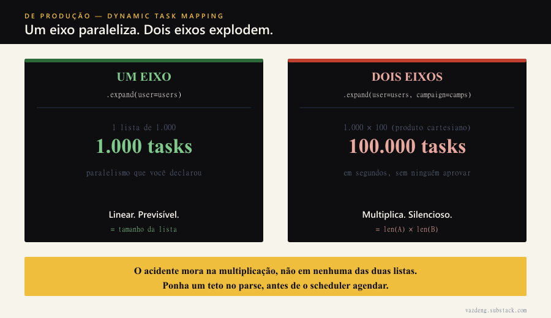

Dois `expand` empilhados no mesmo mapeamento viram um produto cartesiano. 1.000 usuários por 100 campanhas dá 100.000 tasks, criadas em segundos, sem ninguém aprovar nada.

O scheduler do Airflow não te avisa. Ele materializa as 100.000 e segue em frente.

## Por que multiplica quando você achou que somava

Dynamic task mapping é uma das melhores coisas do Airflow. Você não sabe em tempo de escrita quantas tasks vai precisar, então deixa o `.expand()` decidir em runtime a partir de uma lista. Uma lista, um paralelismo saudável. Uso isso sem medo.

O problema aparece quando o mapeamento expande em mais de um eixo. `.expand(user=users, campaign=campaigns)` não combina uma lista com a outra em paralelo. Ele cruza todas contra todas. É `len(users) × len(campaigns)`. Com 1.000 e 100, são 100.000 instâncias de task na fila.

A conta é trivial, e é exatamente por isso que ninguém revisa. Cada lista, olhada isolada, parecia inofensiva. O acidente mora na multiplicação, não em nenhuma das duas pontas. Vi times revisarem cada lista com cuidado e nunca a operação entre elas, porque nenhuma ferramenta obriga a olhar o produto.

## O custo não é o DAG que falha

Não existe guardrail numérico por padrão. O Airflow não pergunta "tem certeza que quer 100 mil tasks?". Ele grava todas no metadata DB, o scheduler engasga pra planejar, o worker pool satura, e o DAG que rodava em minutos vira incidente de madrugada.

O pior caso não é o mapeamento que estoura e falha na cara. Esse pelo menos avisa. É o que tenta rodar, degrada tudo em volta e prende o cluster inteiro por horas. Um fechamento que expande por cliente e por produto acha o produto cartesiano no pior horário possível, e você descobre o número junto com o pager.



## O guardrail que falta

A defesa não é abandonar o `.expand()`. Aprendi a desconfiar dele em mais de um eixo, não a evitá-lo. São três camadas, em ordem de esforço:

Pré-combine antes de mapear. Monte a lista de pares que você realmente quer e mapeie sobre ela. Você troca o cruzamento cego por uma expansão que controla.

Ponha um teto numérico explícito. Um check que falha o DAG no parse se a expansão passar de um limite que você define. Abortar antes de agendar é barato. Abortar no worker, com dezenas de milhares de tasks já na fila, não é. O número exato do teto importa menos que a existência dele: qualquer valor que force alguém a justificar a escala já quebra o silêncio.

Filtre upstream. A maioria dos 100.000 pares não faz sentido de negócio. Corte na fonte, não no mapa. Um join que descarta as combinações inválidas antes do `.expand()` é mais barato que 100.000 tasks que só existem pra falhar.

```python
# Errado: dois eixos cruzam em produto cartesiano
process.expand(user=users, campaign=campaigns)  # 1000 x 100 = 100_000 tasks

# Certo: pré-combina os pares válidos e trava o teto no parse
pares = pares_de_negocio(users, campaigns)       # só o que importa
assert len(pares) <= 5_000, f"expansao estourou: {len(pares)}"
process.expand(par=pares)
```

O teto que eu ponho é uma linha. É mais barato que o incidente que ele evita.

## Quando o cartesiano é o que você quer

Tem caso em que multiplicar é a intenção, não o acidente. Matriz de teste de N versões por M ambientes: você quer todas as combinações, e o produto é o objetivo. A regra não é "nunca expanda em dois eixos". É que, se expandir, você saiba o número antes de o scheduler saber.

Isso vale dobrado em fintech, onde o Airflow é o orquestrador dominante e os pipelines de conciliação cruzam cliente com produto com naturalidade. O eixo que ninguém contou é o que derruba a operação inteira, num fechamento, no pior horário. Não é bug de código. É decisão de escala que não foi tomada.

`.expand()` de um eixo é paralelismo. `.expand()` de dois eixos sem teto é uma aposta que o scheduler sempre aceita. Seu mapeamento sabe quantas tasks vai criar antes de criar, ou você vai descobrir junto com o pager?
