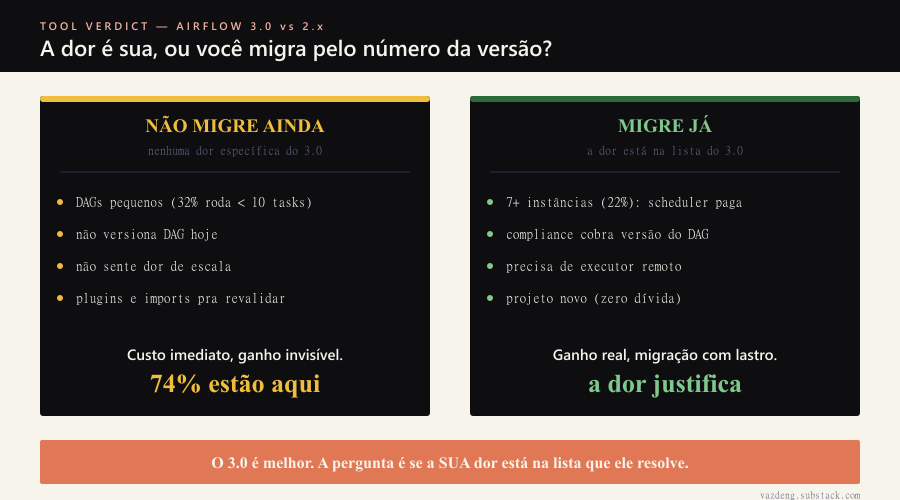

Airflow 3.0 saiu faz seis meses. 26% dos times migraram. Os outros 74% não estão atrasados.

Um levantamento com 5.818 engenheiros de 122 países mostrou isso, e é o número que muda a conversa: migrar pro 3.0 não é a decisão óbvia que o changelog vende. Na maioria dos casos, ficar no 2.x é a escolha certa por enquanto.

## O que o 3.0 entrega de verdade

Três coisas importam, e nenhuma é cosmética.

DAG versioning: você passa a ver qual versão do código rodou cada execução. Acaba o "mas o DAG era outro naquele dia" quando alguém pergunta por que o número de março saiu diferente.

Task SDK: separa a definição da task do runtime. É o que destrava executor remoto e task em outra linguagem sem gambiarra.

Scheduler mais fora do caminho crítico: a arquitetura nova tira pressão do componente que, quando engasga, para tudo.

São ganhos reais. Só que cada um resolve uma dor específica, e é aí que o verdict vira.

## Quando NÃO migrar

Se seus DAGs são pequenos, o 3.0 não muda sua vida. 32% dos times do survey rodam DAGs com menos de 10 tasks. Nesse regime, a arquitetura nova do scheduler é invisível: você paga a migração e não sente o benefício.

Se você não versiona DAG hoje e nunca sofreu com "qual código rodou", DAG versioning é solução pra um problema que você não tem. Recurso bom não é o mesmo que recurso seu.

E a migração 2.x para 3.0 tem breaking changes reais: imports que mudaram, comportamento deprecado, plugins pra revalidar. O custo é imediato e concreto. O ganho é diferido e condicional. Eu não faço essa troca sem uma dor nomeada do outro lado.

## Quando migrar já

Se você roda muitas instâncias, o jogo inverte. 22% dos times operam 7 ou mais, e nessa escala o scheduler-as-service e a arquitetura nova pagam a migração sozinhos.

Se compliance te cobra "qual versão do DAG gerou esse número", o DAG versioning deixa de ser luxo e vira o recurso. Em fintech sob BACEN, rastrear a versão exata do pipeline que produziu um fechamento não é conforto, é requisito de auditoria.

E se você está começando um projeto novo agora, comece no 3.0. Não existe dívida de migração pra pagar, e você já nasce na arquitetura que o ecossistema vai seguir.

## O checklist que eu uso antes de abrir a migração

Antes de tocar num pipeline em produção, eu respondo três perguntas, nessa ordem. Alguém pergunta hoje qual versão do DAG gerou um número e eu não consigo responder? Meu scheduler engasga porque tenho instância demais pro modelo atual? Preciso de executor remoto ou task numa linguagem que o 2.x não deixa rodar direito? Se as três respostas são não, o 3.0 é upgrade de changelog, não de operação, e eu adio. Se qualquer uma é sim, aí a migração tem lastro e vale abrir o esforço com plano de rollback.

O que eu aprendi a não fazer é migrar no automático porque a versão nova apareceu. Toda migração de major é dívida antes de virar ganho, e a conta só fecha quando existe uma dor real esperando do outro lado.

## O verdict

O 3.0 é melhor que o 2.x. Essa nunca foi a pergunta. A pergunta é se a SUA dor específica está na lista curta que ele resolve: rastreabilidade de versão, escala de scheduler, execução remota. Se está, migre e não adie. Se não está, migrar é trocar estabilidade conhecida por breaking changes em nome de um número maior.

Vi time migrar por FOMO de release e passar duas semanas consertando import pra chegar no mesmo lugar. A versão nova não é uma meta. É uma ferramenta que só vale quando encontra a dor que foi feita pra curar.

Você tem a dor que o 3.0 cura, ou está migrando porque saiu a versão nova?
