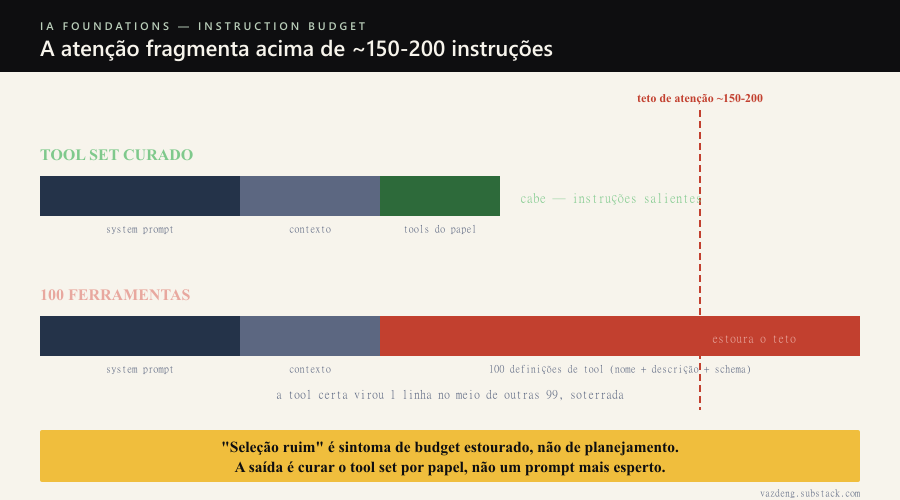

Você deu 100 ferramentas pro seu agente pra ele escolher melhor. Ele começou a escolher pior.

A reação comum é culpar o planejamento: "o agente precisa de um passo de decisão mais esperto". Está errado. O problema não é o cérebro do agente. É que ele não consegue mais ler a lista inteira com atenção.

## Instruction budget: o teto que ninguém declara

Um modelo segue instruções com boa consistência até um teto. Na prática, esse teto fica em torno de 150 a 200 instruções. Acima disso a atenção fragmenta: o modelo começa a misturar ou ignorar as instruções menos salientes.

E o instruction budget não é só o system prompt. É a soma de tudo que compete pela atenção no turno: o system prompt, a base de conhecimento referenciada, o contexto da chamada e, o que quase ninguém conta, a definição de cada ferramenta. Cada tool tem nome, descrição e schema de parâmetros. Vinte ferramentas com descrição decente já são um bloco de instrução do tamanho de um prompt inteiro.

Quando você despeja 100 ferramentas, você não deu mais opção pro agente. Você afogou as instruções que importam num mar de definições que ele nem vai usar naquela tarefa.

## "Seleção ruim" é sintoma, não causa

É por isso que trocar o prompt de decisão não resolve. Você está tentando consertar a escolha quando o problema é que o orçamento de atenção já estourou antes da escolha acontecer. A ferramenta certa está na lista, mas ela virou uma linha no meio de outras noventa e nove.

Aprendi a ler "meu agente escolhe a tool errada" como "meu agente está acima do budget", não como "meu agente é burro". Muda completamente o que você vai fazer a seguir.

## A solução é curar, não planejar

Duas decisões resolvem a maior parte disso, e nenhuma é um prompt mais esperto.

Cure o tool set por papel. O agente não precisa de todas as ferramentas, precisa das ferramentas do trabalho dele. Um agente que escreve SQL não precisa das tools de deploy. Recortar o conjunto por responsabilidade é o que mais devolve atenção.

Carregue sob demanda, não tudo de uma vez (JIT). Em vez de pré-carregar 100 definições, o agente puxa da base só a ferramenta que a tarefa atual pede. O budget fica pro problema, não pro catálogo.

Na minha squad de engenharia de dados eu segurei isso na marra: são 27 agentes, cada um com um tool set enxuto e o system prompt dentro do budget. O anti-padrão que eu bani foi o mega-agente que faz tudo, porque nele a especialização se perde, o instruction budget estoura e não sobra gate natural entre as etapas. Dividir por papel não foi organização estética, foi o que manteve cada agente abaixo do teto de atenção.

## Quando não importa

Agente com três ou quatro ferramentas e um escopo estreito não precisa de nada disso. O budget nem chega perto do teto, e curar seria over-engineering. O custo da curadoria só paga quando o catálogo cresceu a ponto de a ferramenta certa se perder no meio das outras.

Dá pra reconhecer a virada quando o agente passa reto pela ferramenta óbvia e pega uma pior. Ela estava na lista o tempo inteiro, só enterrada fundo demais pra competir pela atenção.

## O que o Ep fixa

Mais ferramenta não é mais capacidade. Acima do budget, é menos. A pergunta antes de adicionar a próxima tool não é "isso ajudaria?", é "isso cabe no orçamento de atenção que ainda me resta?".

Seu agente tem as ferramentas certas, ou tem todas as ferramentas e a atenção pra usar nenhuma direito?
