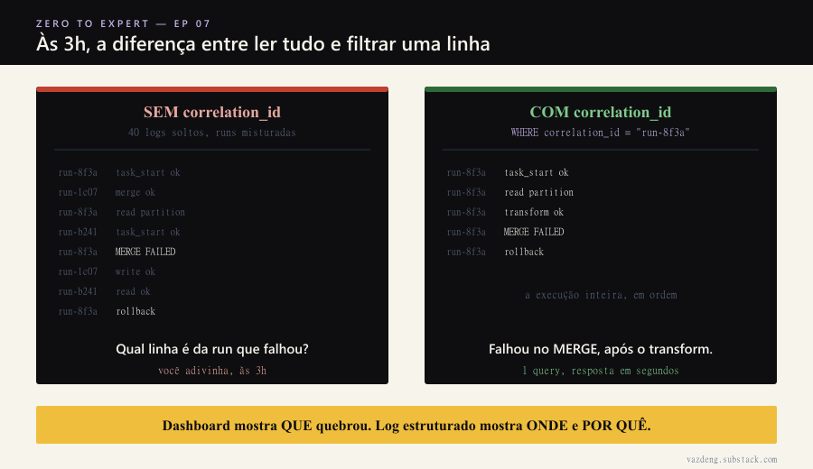

O DAG falhou no MERGE às 3h da manhã. O dashboard estava todo verde às 2h58.

Isso não é contradição, é a natureza do dashboard. Ele mostra o agregado depois que a poeira baixou, não o caminho até a falha. Quando você acorda com o alerta, o gráfico bonito não responde a única pergunta que importa: onde, entre as 40 tasks do pipeline, isso quebrou, e por quê.

## Por que o dashboard não te salva

Um dashboard é um retrato pós-morte. Ele soma, conta e colore, e some com o detalhe no caminho. "Taxa de sucesso alta" não te diz qual execução falhou. "Latência do percentil 95 subiu" não te diz em qual task. O dashboard é ótimo pra saber QUE algo está errado. É péssimo pra saber ONDE.

Às 3h da manhã você não precisa de um número agregado. Precisa reconstruir uma execução específica, task por task, na ordem em que ela aconteceu. É outro tipo de dado.

## Log estruturado é o dado que reconstrói a execução

Log estruturado é log em formato de dados, não de prosa. Em vez de `print("processando cliente X")`, você emite um evento com campos: `{"event": "processa_cliente", "cliente_id": "X", "level": "info", "correlation_id": "run-8f3a"}`.

A virada não é o JSON. É o `correlation_id`. Cada execução do pipeline gera um id único que viaja por todas as tasks. Sem ele, você lê 40 blocos de log soltos e tenta adivinhar quais são da mesma run. Com ele, uma query filtra `correlation_id = "run-8f3a"` e devolve a execução inteira, em ordem, das 40 tasks. Vinte minutos de leitura viram uma linha de filtro.

Eu uso structlog nos meus pipelines exatamente por isso: ele serializa o evento em JSON e carrega um contexto que eu amarro no começo da run e propago. O log deixa de ser texto pra humano ler no desespero e vira tabela pra máquina filtrar.

## O que logar (e o que não é log)

Três campos fazem a maior parte do trabalho: `event` (o que aconteceu, um nome estável, não uma frase), `level` (info, warning, error, pra você filtrar o ruído) e `correlation_id` (a costura). Some a isso o contexto que a task já tem em mãos: o id do registro, a partição, o tamanho do lote.

O que não ajuda: mensagem em prosa livre ("deu erro ao processar"), que nenhuma query consulta, e log sem nível, que te obriga a ler tudo. Aprendi a tratar log como schema, não como diário. Se eu não consigo imaginar a query que vai ler aquele log, ele não devia existir. O nome do evento é a coluna que você vai filtrar daqui a três meses, então ele merece o mesmo cuidado que você daria a um nome de coluna no banco: estável, previsível, sem acento nem espaço.

## Quando não precisa

Script de uma task só, que roda uma vez e você olha o output na hora, não precisa de correlation_id. Ali o `print` resolve. O custo do log estruturado só paga quando há várias tasks, várias execuções e um você-do-futuro tentando reconstruir uma delas sob pressão.

O sinal de que você passou desse ponto: a primeira vez que você abriu o log de um pipeline e não conseguiu dizer, com certeza, quais linhas eram da run que falhou.

## O que o Ep 07 fixa

Dashboard mostra QUE quebrou. Log estruturado mostra ONDE e POR QUÊ. Um é vitrine, o outro é o caminho de volta, e eles não competem: o dashboard te acorda, o log te leva até a task. Investir no primeiro e esquecer o segundo é comprar o alarme de incêndio e deixar a casa sem planta baixa: você sabe que está pegando fogo, mas não sabe por onde correr.

Na próxima madrugada de plantão, você vai filtrar por um `correlation_id` e ler a execução inteira em ordem, ou vai abrir 40 logs soltos e começar a adivinhar?
