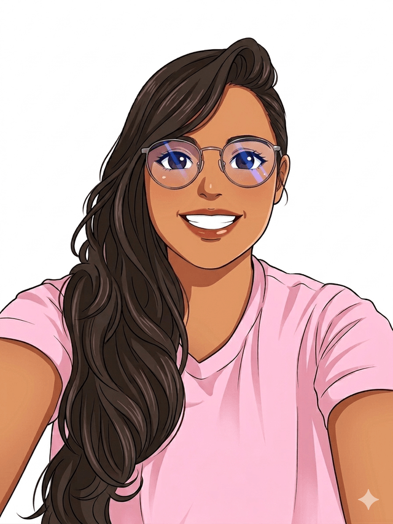

  

Meu nome é Thais Vaz. Sou engenheira de dados há 10 anos, hoje construindo com IA em produção.

Comecei no **Itaú**, onde ganhei o Prêmio Mérito por trabalho em qualidade de dados. Passei pela **EBANX** construindo pipelines ETL em escala. Atuei em projeto de uma big tech americana no Vale do Silício, pela **HCL Technologies**. Hoje sou engenheira de dados sênior no **Bradesco**.

Minha stack principal é **Databricks**. Não porque li um tutorial. Porque é o que roda em produção nos lugares onde trabalhei.

## Por que esse blog existe

Em 2025 entrei como aluna ouvinte no programa de **Métodos Numéricos em Engenharia** na UFPR e em 2026 ingressei oficialmente como mestranda. Minha pesquisa é sobre monitoramento preditivo baseado em IA usando LLMs pra sistemas operacionais.

No meio desse caminho eu percebi uma coisa que me incomodava. Quase ninguém estava escrevendo sobre engenharia de dados de produção em português. Não do jeito que eu queria ler: com profundidade, vindo de quem construiu de verdade, num banco real, com restrições reais de LGPD, SLA e conformidade regulatória.

Então comecei a escrever.

## O que você vai encontrar aqui

Escrevo para quem já sabe o básico de engenharia de dados e quer ver como as coisas funcionam de verdade em produção. Cada post entrega uma decisão, um número com fonte e o caso em que a ideia falha.

A frente principal é **engenharia de dados de produção**: Databricks, Delta Lake, Spark, dbt, Airflow. Decisões reais de arquitetura, erros que cometi e o que aprendi com eles, com contexto brasileiro (LGPD, custo de nuvem em reais) onde for relevante.

A segunda é **IA aplicada a dados**: agentes e LLMs que aguentam produção, com avaliação, custo e segurança no centro.

A terceira são os **bastidores**: o que o mestrado e os meus projetos pessoais ensinam sobre os problemas que você enfrenta todo dia.

Um post novo por semana. A newsletter sai aos sábados.

Se é a sua primeira visita, a página [Comece aqui](/comece/) tem os posts certos para começar.

## Onde me encontrar

- **Newsletter no Substack:** [vazdeng.substack.com](https://vazdeng.substack.com/subscribe?utm_source=blog&utm_medium=sobre&utm_campaign=fase1), o resumo da semana no seu e-mail. Quem assina recebe o [checklist de qualidade de dados](/checklist-qualidade-dados/)
- **GitHub:** [@thaiscvaz](https://github.com/thaiscvaz)
- **LinkedIn:** [thacvaz](https://linkedin.com/in/thacvaz)
- **Contato:** responde qualquer post ou me chama no LinkedIn
